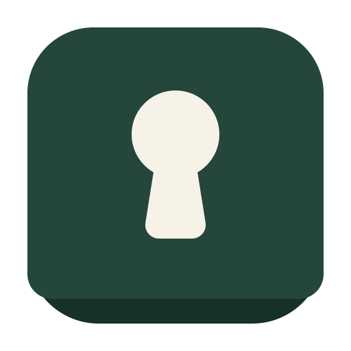

<p align="center"></p>

# Meboard

Put one device's screen on another, and put the text beside it.

Meboard exists for a specific, unglamorous situation: a machine that works fine
with a display that does not. One device shares its own screen, a second device
watches it over a direct WebRTC link, and a shared text sheet underneath carries
the things that are painful to retype blind — support codes, file paths, command
output.

- **Docs:** [ROADMAP.ROADMAP.md](./ROADMAP.ROADMAP.md) · [runbook.runbook.txt](./runbook.runbook.txt) · [QRD.md](./QRD.md) · [BRAND.BRAND.md](./BRAND.BRAND.md)
- **Build instructions for agents:** [README.md](./README.md) (framework conventions)

---

## What it does

| | |
| --- | --- |
| **Share a screen** | Host captures its whole screen or a single window with `getDisplayMedia` |
| **Join by code** | Six characters, no `0/O/1/I/L`, generated per board |
| **Watch live** | Peer to peer over WebRTC; Convex only carries the handshake |
| **Pass text** | Two-way data channel with real selectable text and copy buttons |
| **Point** | Tap the video to drop a marker ring on the host's screen |
| **Type** | `/lab` carries a working adaptive key surface: it offers repairs, learns where your thumb lands, and never rewrites without a tap |

## What it does not do

- **No cursor or keyboard control.** A web page cannot move another machine's
  pointer. For real remote control on ChromeOS, pair Meboard with Chrome Remote
  Desktop's one-time support code and move that code across the text sheet.
- **No relay yet.** STUN only, so both devices need to be reachable — same
  Wi-Fi works; strict carrier NAT will not.
- **One viewer per board.**
- **No recording.** Video is peer to peer; nothing is uploaded.

## Devices this targets

| Device | Role | State |
| --- | --- | --- |
| HP Chromebook (ChromeOS, failing panel) | host | primary target |
| Samsung Galaxy Tab A9 (Android, Chrome) | viewer | primary target |
| Motorola Moto G 5G 2024 (Android, Chrome) | viewer | supported, not yet exercised on hardware |
| Any desktop Chrome/Chromium | host or viewer | supported |

Both devices sign in to the same Meboard account; the board code is what ties the
two sessions together.

## Brand

The keycap-and-keyhole mark, the palette, the voice rules, and the Buffface
crossover are in `BRAND.BRAND.md`. Source assets: `src/assets/meboard-mark.svg`
(app), `public/mark.svg` (favicon), `public/mark-maskable.svg` (PWA),
`src/assets/buffface.svg` (mascot). There is no Freebuff logo in the app chrome;
the one Freebuff door is the Buffface chip in the landing footer and app nav.

## Stack

- Vite + React 19 + TypeScript
- Tailwind v4 + shadcn/ui components
- Convex (database + functions) as the signalling channel
- Convex Auth (email OTP)
- Framer Motion
- Bun as the package manager

## Quickstart

```bash
bun install
bunx convex dev --once      # push functions + regenerate types
bunx tsc -b --noEmit        # typecheck
```

The dev server and Convex dev process are managed by the platform — do not start
them by hand.

### Environment

| Variable | Where | Purpose |
| --- | --- | --- |
| `CONVEX_DEPLOYMENT` | local | Convex deployment selector |
| `VITE_CONVEX_URL` | client | Convex endpoint the app talks to |
| `JWKS`, `JWT_PRIVATE_KEY`, `SITE_URL` | Convex backend | Convex Auth configuration |
| `VITE_TURN_URL`, `VITE_TURN_USER`, `VITE_TURN_CREDENTIAL` | client | planned, Phase 2 — relay for cross-network sessions |

Do not edit `.env` files directly; secrets are managed through the platform UI.

## Using it

1. **Host:** open `/live`, press **Share my screen**, pick *Entire screen*. A
   six-character code appears (and is read aloud by a screen reader).
2. **Viewer:** open `/live` on the other device, type the code, press **Watch**.
3. Both sides now have the video, the marker, and the text sheet.

Screens:

| Route | Access | Purpose |
| --- | --- | --- |
| `/` | public | landing |
| `/auth` | public | email OTP sign-in; honours `?returnTo=` |
| `/dashboard` | protected | board overview, entry to Live |
| `/live` | protected | share, join, watch, text channel |
| `/lab` | protected | adaptive key surface, repair inspector, hit-target readout, agent bus |
| `/rail` | protected | compact companion view of Live (same session, narrow layout) |

## How a session works

```
host browser                    Convex                     viewer browser
     |                             |                             |
     | getDisplayMedia()           |                             |
     | createRoom ----------------->|  rooms: {code, hostId, ...} |
     |                             |<------------- joinRoom -----|
     |                             |   clears signals, new       |
     |                             |   viewerToken, status=live  |
     |<-- roomState (reactive) ----|                             |
     | createOffer + gather ICE    |                             |
     | postSignal("offer") ------->|  signals: {from, kind, sdp} |
     |                             |------ reactive query ------>|
     |                             |<-------- postSignal("answer")|
     |<-- setRemoteDescription ----|                             |
     |========= direct WebRTC media + data channel ==============>|
```

Design choices worth knowing before you change them:

- **Full ICE gathering, not trickle.** `waitForCandidates` waits for gathering to
  finish (capped at 2.5 s) and sends one self-contained SDP. Two messages total,
  no candidate-ordering bugs. Cost: up to a 2.5 s slower start on a hostile
  network.
- **One offer per join.** The host reacts to a changing `viewerToken`, so a
  reloaded viewer always gets a fresh handshake and stale answers cannot land on
  a live connection.
- **Newest signal wins.** `postSignal` deletes the previous message with the same
  `from` + `kind` pair, so the table never accumulates SDP.
- **Data channel messages** are JSON: `{ "t": "text", "body": string }` and
  `{ "t": "ping", "x": number, "y": number }` where `x`/`y` are 0–1 relative to
  the video element.

## Data model

`src/convex/schema.ts`

**rooms**

| Field | Type | Notes |
| --- | --- | --- |
| `code` | string | 6 chars from `23456789ABCDEFGHJKMNPQRSTUVWXYZ` |
| `hostId` | `Id<"users">` | board owner |
| `hostName` | string? | display name captured at creation |
| `status` | `waiting` \| `live` \| `ended` | |
| `viewerId` | `Id<"users">`? | single viewer |
| `viewerName` | string? | |
| `viewerToken` | string? | regenerated on every join; drives renegotiation |

Indexes: `by_code`, `by_host`.

**signals**

| Field | Type | Notes |
| --- | --- | --- |
| `roomId` | `Id<"rooms">` | |
| `from` | `host` \| `viewer` | |
| `kind` | `offer` \| `answer` | SDP JSON in `payload` |
| `payload` | string | `JSON.stringify(pc.localDescription)` |

Index: `by_room`.

Functions in `src/convex/live.ts`: `myRoom`, `roomState`, `signals` (queries);
`createRoom`, `joinRoom`, `postSignal`, `endRoom` (mutations). All require an
authenticated caller and check board membership.

## Accessibility notes

- The text sheet is real DOM text in a `role="log"` region with
  `aria-live="polite"` — screen readers read it as text, not as an image.
- Connection status is announced via `aria-live="polite"`.
- All controls are native buttons/inputs and reachable by keyboard.
- The host flow is keyboard-operable in principle (Tab/Enter through Chrome's
  capture picker); it has **not** yet been verified screen-reader-only.
- Screen mirroring shows pixels. If you need speech, the terminal-relay work in
  Phase 3 of the roadmap is the answer — a mirrored curses UI is still silent.

## Project map

```
src/
  main.tsx                 router + providers
  pages/Landing.tsx        marketing page
  pages/Auth.tsx           email OTP (do not restructure)
  pages/Dashboard.tsx      boards overview
  pages/Live.tsx           capture, join, watch, text channel
  components/AppNav.tsx    protected-page navigation
  components/Buffface.tsx  the Freebuff colophon chip and dialog
  assets/                  Meboard mark + Buffface (SVG sources)
  components/KeyboardSurface.tsx  the adaptive key surface used by /lab
  components/KeyholeBanner.tsx    persona line, polite live region + mute
  components/ScrollCopy.tsx       scroll-inked headings and body copy
  components/BusPanel.tsx         token, curl snippets, live agent log
  components/ui/           shadcn primitives
  convex/schema.ts         rooms + signals + bus + auth tables
  convex/live.ts           signalling queries and mutations
  convex/bus.ts            agent bus: tokens, feed, publish, polling
  convex/http.ts           POST /bus/publish · GET /bus/poll
  convex/users.ts          currentUser helper (read-only)
  hooks/use-auth.ts        auth state
  hooks/use-keyhole.ts     persona instance per page
  hooks/use-target-memory.ts  persisted hit-target offsets + session counter
  lib/keyboard/            geometry, lexicon, repair, adaptation, spec
  lib/persona/             engine, voice format, bus seam, Keyhole, spec
```

## Verification

```bash
bunx convex dev --once && bunx tsc -b --noEmit
bun src/lib/keyboard/selftest.ts   # 45 checks
bun src/lib/persona/selftest.ts    # 37 checks
```

All four must exit 0. The two specs are executable and dependency-free; the
manual smoke test in `runbook.runbook.txt` is still the hardware acceptance
check, and nothing here has been run on a real device.

## Conventions

- Do not modify `src/convex/auth.ts`, `src/convex/auth.config.ts`, or
  `src/convex/auth/emailOtp.ts`.
- Never hand-edit `src/convex/_generated/*`; run codegen.
- Keep `server.hmr: false` in `vite.config.ts`.
- User-facing failures throw `ConvexError` with a plain-language message.
